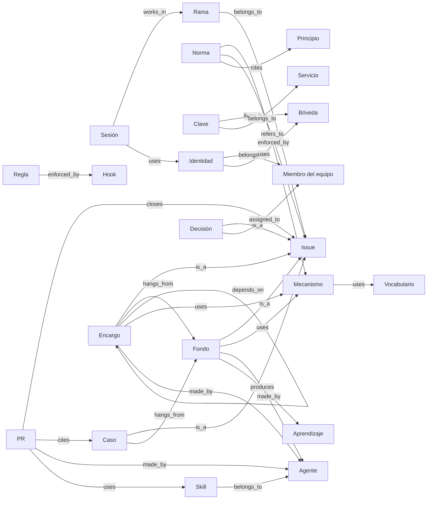
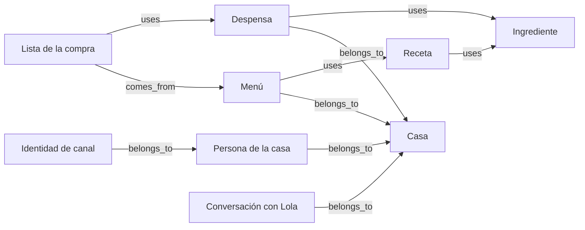
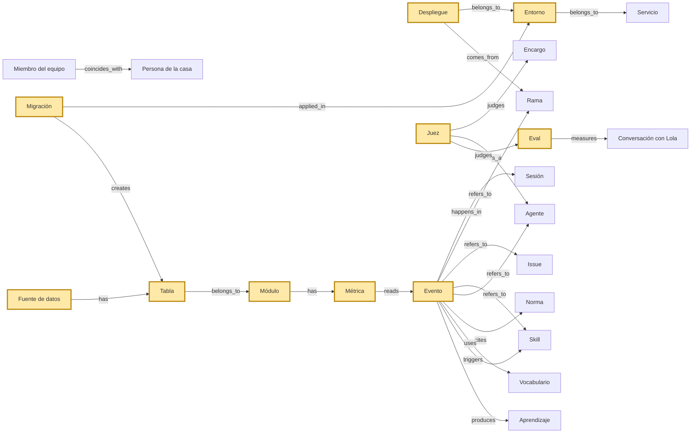

# Mapa de entidades

Este mapa lista las entidades de MenuPlan y cómo se relacionan. Lo guarda
`ops/entidades.json`; `ops/entidades.test.js` falla si una entidad o una
relación sobra o falta aquí, en cualquiera de los dos sentidos. Los principios
que las rigen, en [N0-principios.md](N0-principios.md). La definición de cada
entidad no está aquí: vive en el glosario (`ops/glosario/terminos/`), en la
ficha del término que dice la columna «Término del glosario».

Una **entidad** es una cosa con id estable y definición propia. Tiene un **eje**:

- **horizontal**: cómo trabajamos (sesiones, normas, agentes, issues, PR).
- **vertical**: el producto HoMenu (casas, recetas, menús, Lola).
- **bridge** (puente): lo que cruza los dos. Se define una vez y los dos ejes la usan igual.

Hoy hay 41 entidades: 22 horizontales, 9 verticales y 10 puentes.
Las verticales llevan solo id y nombre fiables: su detalle queda fuera de esta fase.
Los ids van en inglés (decisión de Pablo del 11 oct 2026); los nombres y las notas, en castellano.

## Los puentes

Un puente es una palabra que significa lo mismo a los dos lados o que une
un lado con el otro. Son los sitios donde el lenguaje se rompe más.

| id | Nombre | Eje | Término del glosario | Fuente hoy | Registro |
|---|---|---|---|---|---|
| `environment` | Entorno | bridge | entorno | `ops/INVENTARIO.md` | without_registry |
| `deployment` | Despliegue | bridge | despliegue | ninguna | without_registry |
| `event` | Evento | bridge | evento | `.claude/hooks/eventos.mjs` | partial |
| `metric` | Métrica | bridge | métrica | `ops/metricas.json` | with_registry |
| `eval` | Eval | bridge | eval | `scripts/bot-evals.json` | partial |
| `judge` | Juez | bridge | juez | `.claude/agents` | partial |
| `migration` | Migración | bridge | migración | `supabase/ESTADO.md` | partial |
| `table` | Tabla | bridge | tabla | `ops/MODULOS.json` | partial |
| `data-source` | Fuente de datos | bridge | fuente de datos | `src/data/model.js` | with_registry |
| `module` | Módulo | bridge | módulo | `ops/MODULOS.json` | with_registry |

Qué es cada uno en cada lado:

- **environment**: Proceso: dónde corre y se prueba el código. Producto: dónde viven los datos de las casas, que son una sola base para todos.
- **deployment**: Proceso: lo que sale de una rama. Producto: la versión que ven las casas.
- **event**: Proceso: lo que registran los hooks y los scripts. Producto: lo que registra user_events.
- **metric**: Proceso: cifra de cumplimiento del flujo. Producto: cifra de uso o de coste de una pieza.
- **eval**: Proceso: la medida del antes y el después. Producto: lo que se mide es Lola.
- **judge**: Proceso: quien juzga un cambio. Producto: evaluador y seguridad también juzgan lo que sale a las casas.
- **migration**: Proceso: pasa por un gateway y un juez. Producto: cambia la base de las casas.
- **table**: Proceso: la crea una migración y la custodia un módulo. Producto: guarda los datos de las casas.
- **data-source**: Proceso: se declara con rol y estado. Producto: los datos que lee la app.
- **module**: Proceso: tiene dueño y métricas. Producto: agrupa las tablas y los ficheros de la app.

## Eje horizontal: cómo trabajamos

| id | Nombre | Eje | Término del glosario | Fuente hoy | Registro |
|---|---|---|---|---|---|
| `session` | Sesión | horizontal | sesión | ninguna | without_registry |
| `team-member` | Miembro del equipo | horizontal | persona | `CLAUDE.md` | without_registry |
| `identity` | Identidad | horizontal | identidad | `scripts/lib/tokenSesion.mjs` | partial |
| `service` | Servicio | horizontal | servicio | `ops/INVENTARIO.md` | without_registry |
| `norm` | Norma | horizontal | norma | `ops/normas.json` | with_registry |
| `learning` | Aprendizaje | horizontal | aprendizaje | ninguna | without_registry |
| `mechanism` | Mecanismo | horizontal | mecanismo | `ops/mecanismos.json` | with_registry |
| `secret` | Clave | horizontal | clave | `ops/INVENTARIO.md` | without_registry |
| `vault` | Bóveda | horizontal | bóveda | `ops/INVENTARIO.md` | without_registry |
| `agent` | Agente | horizontal | agente | `.claude/agents` | with_registry |
| `skill` | Skill | horizontal | skill | `.claude/skills` | with_registry |
| `rule` | Regla | horizontal | regla | `.claude/rules` | partial |
| `hook` | Hook | horizontal | hook | `.claude/settings.json` | partial |
| `issue` | Issue | horizontal | issue | `scripts/lib/issues.mjs` | with_registry |
| `root-problem` | Fondo | horizontal | fondo | `scripts/lib/fondos.mjs` | with_registry |
| `case` | Caso | horizontal | caso | `scripts/lib/issues.mjs` | with_registry |
| `assignment` | Encargo | horizontal | encargo | `scripts/lib/issues.mjs` | with_registry |
| `decision` | Decisión | horizontal | decisión | `ops/DECISIONES.md` | partial |
| `pull-request` | PR | horizontal | pr | ninguna | without_registry |
| `branch` | Rama | horizontal | rama | ninguna | without_registry |
| `vocabulary` | Vocabulario | horizontal | vocabulario | `ops/vocabularios-vida.json` | partial |
| `principle` | Principio | horizontal | principio | `ops/principios/_catalogo.json` | with_registry |

## Eje vertical: el producto HoMenu

| id | Nombre | Eje | Término del glosario | Fuente hoy | Registro |
|---|---|---|---|---|---|
| `household` | Casa | vertical | ninguno | `specs/modelo-datos.md` | partial |
| `person` | Persona de la casa | vertical | persona de la casa | `specs/modelo-datos.md` | partial |
| `channel-identity` | Identidad de canal | vertical | ninguno | `ops/MODULOS.json` | partial |
| `recipe` | Receta | vertical | ninguno | `src/data/recipes` | partial |
| `ingredient` | Ingrediente | vertical | ninguno | `src/data/ingredients.json` | partial |
| `menu` | Menú | vertical | ninguno | `specs/menu-generation.md` | partial |
| `pantry` | Despensa | vertical | ninguno | `specs/modelo-datos.md` | partial |
| `shopping-list` | Lista de la compra | vertical | ninguno | `specs/shopping-list.md` | partial |
| `lola-conversation` | Conversación con Lola | vertical | ninguno | `specs/plan-bot-mensajeria.md` | partial |

## Los puentes en el mapa

Los puentes van en amarillo con borde grueso. Salen todas las relaciones que tocan un puente o cruzan de un eje al otro.

## Cómo leerlo

- La flecha va de quien guarda el campo hacia lo que apunta. Se anota una sola vez.
- La etiqueta es la relación, de un vocabulario cerrado (`RELATIONS` en `ops/entidades.test.js`).
- Dónde se guarda hoy cada relación está en `ops/entidades.json` (`stored_as` y `stored_in`). `none` quiere decir que la relación existe y ningún campo la guarda.
- «Registro» dice cómo vive hoy la entidad: `with_registry` (fichero propio con id y test), `partial` o `without_registry` (solo prosa o logs).
