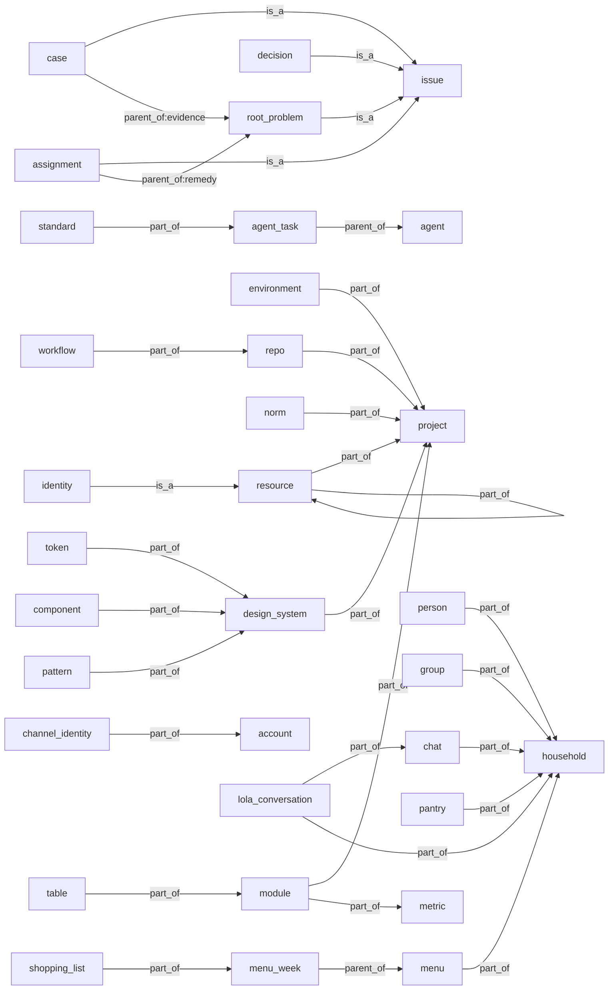

# Mapa de entidades

Este mapa lo **genera** `node scripts/mapa-entidades.mjs --escribir` de `ops/entidades.json`; no se edita a mano y
`ops/entidades.test.js` falla si no coincide con el dato. Los principios que rigen el registro, en
[N0-principios.md](N0-principios.md); el análisis que lo sostiene, en [SUPER-TABLA.md](SUPER-TABLA.md). La definición de cada
entidad no está aquí: vive en el glosario (`ops/glosario/terminos/`), en la ficha del término de la columna «Término del glosario».

Una **entidad** es una cosa con id estable y definición propia. Cada una dice tres cosas de sus piezas:

- **alcance** (`scope`): `horizontal` si sus piezas son de la factoría (cómo trabajamos), `vertical` si cuelgan siempre de un proyecto
  (el producto HoMenu hoy) y `both` si las hay de las dos clases, y cada pieza declara su proyecto o ninguno;
- **nivel** (`level`): `meta` (lo que hace buena una pieza de la familia), `template` (la plantilla de la que salen) o `piece` (la pieza);
- **familia** (`family`): para agrupar al leer; no es un eje.

Un **puente** ya no es un valor: es una entidad de alcance `both`, y se calcula. Las relaciones llevan clase (`is_a`, `part_of`,
`parent_of` o `reference`) y cardinalidad. La contención va de la factoría al proyecto y de este al entorno (`part_of`).
Los ids van en inglés (decisión de Pablo del 11 oct 2026); los nombres y las notas, en castellano.

Hoy hay 54 entidades activas: 22 horizontales, 22 verticales y 10 de los dos lados (puentes).
Las relaciones son 93: is_a 5, parent_of 4, part_of 23, reference 61.

## Horizontales: la factoría

Sus piezas no cuelgan de ningún proyecto.

| id | Nombre | Alcance | Nivel | Familia | Término del glosario | Fuente hoy | Registro |
|---|---|---|---|---|---|---|---|
| `session` | Sesión | horizontal | piece | work | sesión | ninguna | without_registry |
| `team-member` | Miembro del equipo | horizontal | piece | access | persona | `CLAUDE.md` | without_registry |
| `identity` | Identidad | horizontal | piece | access | identidad | `scripts/lib/tokenSesion.mjs` | partial |
| `service` | Servicio | horizontal | piece | access | servicio | `ops/INVENTARIO.md` | without_registry |
| `mechanism` | Mecanismo | horizontal | template | rules | mecanismo | `ops/mecanismos.json` | with_registry |
| `agent` | Agente | horizontal | piece | agents | agente | `.claude/agents` | with_registry |
| `skill` | Skill | horizontal | piece | agents | skill | `.claude/skills` | with_registry |
| `hook` | Hook | horizontal | piece | agents | hook | `.claude/settings.json` | partial |
| `issue` | Issue | horizontal | piece | work | issue | `scripts/lib/issues.mjs` | with_registry |
| `root-problem` | Fondo | horizontal | piece | work | fondo | `scripts/lib/fondos.mjs` | with_registry |
| `case` | Caso | horizontal | piece | work | caso | `scripts/lib/issues.mjs` | with_registry |
| `assignment` | Encargo | horizontal | piece | work | encargo | `scripts/lib/issues.mjs` | with_registry |
| `decision` | Decisión | horizontal | piece | work | decisión | `ops/DECISIONES.md` | partial |
| `pull-request` | PR | horizontal | piece | work | pr | ninguna | without_registry |
| `branch` | Rama | horizontal | piece | work | rama | ninguna | without_registry |
| `source` | Fuente documental | horizontal | piece | rules | fuente documental | `ops/fuentes-documentales/_catalogo.json` | with_registry |
| `standard` | Estándar | horizontal | piece | rules | estándar | `ops/estandares-agentes.json` | with_registry |
| `plane` | Plano | horizontal | meta | measure | plano | `ops/planos.json` | with_registry |
| `agent-task` | Tarea de agente | horizontal | piece | agents | tarea de agente | `ops/estandares-agentes.json` | with_registry |
| `project` | Proyecto | horizontal | piece | structure | proyecto | `ops/entidades.json` | with_registry |
| `design-profile` | Perfil de diseño | horizontal | template | design | perfil de diseño | `ops/diseno/bloques.json` | with_registry |
| `assignment-type` | Tipo de encargo | horizontal | template | work | tipo de encargo | `ops/tipos-de-encargo.json` | with_registry |

## Verticales: el producto

Sus piezas cuelgan siempre de un proyecto. Las de la familia `home`, `food` y `lola` están solo en el registro: no tienen más migraciones ni datos de familias que los que ya existen.

| id | Nombre | Alcance | Nivel | Familia | Término del glosario | Fuente hoy | Registro |
|---|---|---|---|---|---|---|---|
| `migration` | Migración | vertical | piece | delivery | migración | `supabase/ESTADO.md` | partial |
| `table` | Tabla | vertical | piece | data | tabla | `ops/MODULOS.json` | partial |
| `data-source` | Fuente de datos | vertical | piece | data | fuente de datos | `src/data/model.js` | with_registry |
| `module` | Módulo | vertical | piece | data | módulo | `ops/MODULOS.json` | with_registry |
| `household` | Casa | vertical | piece | home | — | `specs/modelo-datos.md` | partial |
| `person` | Persona de la casa | vertical | piece | home | persona de la casa | `specs/modelo-datos.md` | partial |
| `channel-identity` | Identidad de canal | vertical | piece | home | — | `ops/MODULOS.json` | partial |
| `recipe` | Receta | vertical | piece | food | — | `src/data/recipes` | partial |
| `ingredient` | Ingrediente | vertical | piece | food | — | `src/data/ingredients.json` | partial |
| `menu` | Menú | vertical | piece | food | — | `specs/menu-generation.md` | partial |
| `pantry` | Despensa | vertical | piece | food | — | `specs/modelo-datos.md` | partial |
| `shopping-list` | Lista de la compra | vertical | piece | food | — | `specs/shopping-list.md` | partial |
| `lola-conversation` | Conversación con Lola | vertical | piece | lola | — | `specs/plan-bot-mensajeria.md` | partial |
| `repo` | Repositorio | vertical | piece | structure | repositorio | `ops/entidades.json` | partial |
| `design-system` | Sistema de diseño | vertical | piece | design | sistema de diseño | `src/design/tokens.js` | partial |
| `token` | Token de diseño | vertical | piece | design | token de diseño | `src/design/tokens.js` | with_registry |
| `component` | Componente de diseño | vertical | piece | design | componente de diseño | `DESIGN_SYSTEM.md` | partial |
| `pattern` | Patrón de diseño | vertical | piece | design | patrón de diseño | `DESIGN_SYSTEM.md` | partial |
| `account` | Cuenta | vertical | piece | home | — | `ops/MODULOS.json` | partial |
| `group` | Grupo | vertical | piece | home | — | `supabase/migrations/0079_personas_y_grupos.sql` | partial |
| `menu-week` | Semana de menú | vertical | piece | food | — | `supabase/migrations/0005_multiweek_menus.sql` | partial |
| `chat` | Chat | vertical | piece | lola | — | `supabase/migrations/0057_bot_cimientos.sql` | partial |

## Puentes: de los dos lados

Sirven a la factoría y a un proyecto, y cada una dice qué es a cada lado. El alcance se decide por a quién sirve la pieza, no por dónde está el fichero: que todo viva hoy en el repo de HoMenu no hace a nadie both.

| id | Nombre | Alcance | Nivel | Familia | Término del glosario | Fuente hoy | Registro |
|---|---|---|---|---|---|---|---|
| `environment` | Entorno | both | piece | delivery | entorno | `ops/INVENTARIO.md` | without_registry |
| `event` | Evento | both | piece | measure | evento | `.claude/hooks/eventos.mjs` | partial |
| `norm` | Norma | both | meta | rules | norma | `ops/normas.json` | with_registry |
| `metric` | Métrica | both | piece | measure | métrica | `ops/metricas.json` | with_registry |
| `eval` | Eval | both | piece | measure | eval | `scripts/bot-evals.json` | partial |
| `vocabulary` | Vocabulario | both | piece | rules | vocabulario | `ops/vocabularios-vida.json` | partial |
| `principle` | Principio | both | meta | rules | principio | `ops/principios/_catalogo.json` | with_registry |
| `resource` | Recurso | both | template | access | recurso | `ops/recursos.json` | with_registry |
| `control` | Control | both | piece | rules | control | `ops/normas.json` | partial |
| `workflow` | Workflow | both | piece | delivery | workflow | `.github/workflows` | partial |

Qué es cada puente a cada lado:

- **environment**: Proceso: dónde corre y se prueba el código. Producto: dónde viven los datos de las casas, que son una sola base para todos.
- **event**: Proceso: lo que registran los hooks y los scripts. Producto: lo que registra user_events.
- **norm**: Proceso: obligaciones del flujo, la escritura y la infra. Producto: obligaciones sobre el bot, los datos, el catálogo y la interfaz (82 de 183 normas, según el análisis).
- **metric**: Proceso: cifra de cumplimiento del flujo. Producto: cifra de uso o de coste de una pieza.
- **eval**: Proceso: la medida del antes y el después. Producto: lo que se mide es Lola.
- **vocabulary**: Proceso: listas cerradas de ops y scripts/lib. Producto: las de src/lib/vocabularios.js, que además llevan CHECK en la base.
- **principle**: Proceso: principios propios de la casa (ops/principios). Producto: los 40 principios de producto y los 15 de redacción, leídos de su catálogo.
- **resource**: Proceso: GitHub y 1Password. Producto: Supabase, Telegram y Vercel. Hetzner sirve a las dos cosas.
- **control**: Proceso: tests y scripts de ops/ y scripts/. Producto: tests de supabase/ y src/ que vigilan normas de datos y de interfaz.
- **workflow**: Proceso: fondos, planos, flujo semanal, tests, dependabot y agente de fallos. Producto: vigía de Lola, bot semanal, salud del despliegue, mercadona-sync e iOS (por el nombre de cada fichero).

## Proyectos

La factoría es la raíz implícita: una pieza sin proyecto cuelga de ella.

| id | Nombre | Repositorios | Nota |
|---|---|---|---|
| `homenu` | HoMenu | `pabloam89/MenuPlan` | El producto: la app y Lola. Comparte repo con la factoría. |
| `panel` | Panel de la factoría | `pabloam89/homenu-panel` | Herramienta interna con su propio repo privado y su servidor. |

## Estructura: tipo de, parte de, hijo de

Las flechas van de la pieza al todo, al tipo o al padre (el hijo apunta a su padre).

## Relaciones is_a (5)

| de | verbo | a | cardinalidad | cómo se guarda |
|---|---|---|---|---|
| `root-problem` | is_a | `issue` | one_to_one | field: etiqueta tipo:fondo |
| `case` | is_a | `issue` | one_to_one | field: etiqueta tipo:caso |
| `assignment` | is_a | `issue` | one_to_one | field: etiqueta tipo:encargo |
| `decision` | is_a | `issue` | one_to_one | field: etiqueta tipo:decision |
| `identity` | is_a | `resource` | many_to_one | ningún campo: tipos cuenta, app, service-account y deploy-key de recursos.json; la identidad no tiene registro propio |

## Relaciones part_of (23)

| de | verbo | a | cardinalidad | cómo se guarda |
|---|---|---|---|---|
| `environment` | belongs_to | `project` | many_to_one | ningún campo: hoy solo en la prosa de ops/INVENTARIO.md |
| `repo` | belongs_to | `project` | many_to_one | file: projects[].repos (este fichero) |
| `norm` | belongs_to | `project` | many_to_one | field: project (solo las normas verticales, en ops/proyectos/<id>/normas.json); una norma horizontal no lo lleva y cuelga de la factoría (#704) |
| `resource` | belongs_to | `project` | many_to_one | ningún campo: recursos.json no guarda de qué proyecto es cada recurso (sin campo); sin project, cuelga de la factoría |
| `design-system` | belongs_to | `project` | many_to_one | ningún campo: hoy solo en la prosa de docs/diseno/META-DISENO.md |
| `module` | belongs_to | `project` | many_to_one | ningún campo: todos son de HoMenu; MODULOS.json no lo dice |
| `table` | belongs_to | `module` | many_to_one | field: tablas.<t>.dueno (MODULOS.json) |
| `module` | has | `metric` | one_to_many | field: metricas[] (MODULOS.json) |
| `resource` | belongs_to | `resource` | many_to_one | field: op://<bóveda>/<ficha>/<campo>: una clave vive en una bóveda |
| `workflow` | belongs_to | `repo` | many_to_one | field: carpeta .github/workflows del repo |
| `token` | belongs_to | `design-system` | many_to_one | file: src/design/tokens.js |
| `component` | belongs_to | `design-system` | many_to_one | file: sección 6 de DESIGN_SYSTEM.md |
| `pattern` | belongs_to | `design-system` | many_to_one | file: DESIGN_SYSTEM.md |
| `standard` | belongs_to | `agent-task` | one_to_one | field: campos del estándar dentro de cada tarea (estandares-agentes.json) |
| `person` | belongs_to | `household` | many_to_one | field: persona.household_id, clave ajena con on delete cascade |
| `group` | belongs_to | `household` | many_to_one | field: grupo.household_id, clave ajena con on delete cascade |
| `chat` | belongs_to | `household` | many_to_one | field: bot_chats.household_id, clave ajena con on delete cascade |
| `pantry` | belongs_to | `household` | many_to_one | field: user_pantry.household_id (clave ajena, admite nulo: 6 de 116 filas sin casa) |
| `menu` | belongs_to | `household` | many_to_one | field: user_menus.household_id (clave ajena, admite nulo: 17 de 147 filas sin casa) |
| `channel-identity` | belongs_to | `account` | many_to_one | field: bot_identities.user_id → auth.users, on delete cascade |
| `shopping-list` | belongs_to | `menu-week` | one_to_one | field: user_menu_weeks.shopping (jsonb); además hay una vista derivada sin guardar |
| `lola-conversation` | belongs_to | `chat` | many_to_one | field: (channel, chat_id) por texto, sin clave ajena |
| `lola-conversation` | belongs_to | `household` | many_to_one | field: bot_messages.household_id (admite nulo) |

## Relaciones parent_of (4)

| de | verbo | a | cardinalidad | cómo se guarda |
|---|---|---|---|---|
| `case` | hangs_from (evidence) | `root-problem` | many_to_one | field: sub-issue de GitHub; copia en ficha.casos |
| `assignment` | hangs_from (remedy) | `root-problem` | many_to_one | field: sub-issue de GitHub; copias en ficha.encargos y encargo.fondo |
| `agent-task` | hangs_from | `agent` | many_to_one | field: agentes.<id>.tareas[] (estandares-agentes.json) |
| `menu-week` | hangs_from | `menu` | many_to_one | field: user_menu_weeks (user_id, menu_id), clave ajena con on delete cascade |

## Relaciones reference (61)

| de | verbo | a | cardinalidad | cómo se guarda |
|---|---|---|---|---|
| `norm` | cites | `principle` | many_to_one | field: principio |
| `principle` | cites | `source` | many_to_many | field: fuentes[].fuente |
| `standard` | cites | `source` | many_to_many | field: reglas[].fuente |
| `norm` | refers_to | `issue` | many_to_one | field: issue |
| `norm` | enforced_by | `mechanism` | many_to_one | ningún campo: el ejecutor guarda un valor de EJECUTORES, no un id de mecanismo (github_regla no es regla_github) |
| `norm` | enforced_by | `control` | many_to_one | field: control y control_tipo |
| `norm` | enforced_by | `hook` | many_to_many | ningún campo: el ejecutor guardia guarda un tipo, no el hook concreto |
| `standard` | reads | `norm` | many_to_many | ningún campo: consulta por ámbito y acción, calculada; no se copia |
| `session` | works_in | `branch` | one_to_one | field: rama (ficha local de la sesión) |
| `session` | uses | `identity` | many_to_one | ningún campo |
| `identity` | belongs_to | `team-member` | many_to_one | ningún campo |
| `resource` | uses | `service` | many_to_one | field: servicio (ops/recursos.json) |
| `resource` | assigned_to | `team-member` | many_to_one | field: dueno (ops/recursos.json: pablo, alvaro, ambos o por-confirmar) |
| `environment` | uses | `service` | many_to_one | ningún campo: Vercel y Supabase; hoy solo en la prosa de ops/INVENTARIO.md |
| `workflow` | uses | `environment` | many_to_many | field: environment: del workflow (lo declaran 5 de 11) |
| `issue` | belongs_to | `repo` | many_to_one | ningún campo |
| `pull-request` | belongs_to | `repo` | many_to_one | ningún campo |
| `migration` | applied_in | `environment` | many_to_one | file: supabase/ESTADO.md |
| `migration` | creates | `table` | one_to_many | ningún campo: el vínculo vive en el SQL; lo extrae scripts/lib/migraciones.mjs |
| `data-source` | has | `table` | many_to_many | field: tablas (solo 4 de 40 fuentes) |
| `event` | happens_in | `session` | many_to_one | field: sesion (eventos.jsonl) |
| `event` | refers_to | `branch` | many_to_one | field: rama (eventos.jsonl) |
| `event` | refers_to | `issue` | many_to_one | field: issue (eventos.jsonl) |
| `event` | refers_to | `skill` | many_to_one | field: nombre cuando evento es skill_cargada (campo polimórfico, eventos.mjs:11) |
| `event` | refers_to | `agent` | many_to_one | field: nombre cuando evento es agente_lanzado (campo polimórfico, eventos.mjs:11) |
| `event` | cites | `norm` | many_to_one | field: norma |
| `event` | uses | `vocabulary` | many_to_one | file: EVENTOS (constante de eventos.mjs) |
| `event` | triggers | `skill` | many_to_many | ningún campo: propuesta de Pablo, se define en #568 |
| `event` | refers_to | `root-problem` | many_to_one | ningún campo: evento «aprendizaje registrado», propuesta de Pablo (#568); el aprendizaje es un campo del fondo |
| `mechanism` | uses | `vocabulary` | many_to_one | file: escalera (escalas.mjs) |
| `metric` | reads | `event` | many_to_many | file: lineas (metricas.json) |
| `eval` | measures | `lola-conversation` | many_to_many | file: scripts/bot-evals.json |
| `agent` | judges | `assignment` | many_to_many | field: juez (bloque encargo) |
| `agent` | judges | `eval` | many_to_many | ningún campo |
| `agent` | uses | `skill` | many_to_many | field: skills: de la cabecera del agente (precarga) |
| `skill` | belongs_to | `agent` | many_to_one | field: dueno (metadatos de la skill) |
| `plane` | refers_to | `agent` | many_to_many | field: agentes (ops/planos.json) |
| `assignment-type` | refers_to | `agent` | many_to_many | field: pasos (ops/tipos-de-encargo.json) |
| `assignment` | uses | `assignment-type` | many_to_one | field: assignment_type y subtype (bloque encargo) |
| `assignment` | uses | `mechanism` | many_to_one | field: mecanismo (bloque encargo) |
| `assignment` | made_by | `agent` | many_to_one | field: constructor (bloque encargo) |
| `assignment` | depends_on | `assignment` | many_to_many | field: depende_de (bloque encargo) |
| `root-problem` | uses | `mechanism` | many_to_one | ningún campo: barrera guarda un escalón, no un id de mecanismo; ficha.mecanismo es texto libre |
| `root-problem` | made_by | `agent` | many_to_one | field: capa_agente (ficha del fondo) |
| `decision` | assigned_to | `team-member` | many_to_one | field: asignado (GitHub) |
| `branch` | belongs_to | `issue` | many_to_one | field: <área>/<n>-<nombre> |
| `pull-request` | closes | `issue` | many_to_many | field: Closes |
| `pull-request` | cites | `case` | many_to_many | field: Casos: |
| `pull-request` | made_by | `agent` | many_to_one | field: Agente: |
| `pull-request` | uses | `skill` | many_to_many | field: Runbook: |
| `team-member` | coincides_with | `person` | many_to_many | ningún campo |
| `design-system` | uses | `design-profile` | many_to_one | field: Perfil N2 (bloque A de ops/diseno/bloques.json) |
| `component` | uses | `token` | many_to_many | ningún campo: la ficha de componente que pide META-DISENO.md aún no existe |
| `pattern` | uses | `component` | many_to_many | ningún campo: cada patrón dice los componentes que usa, en prosa |
| `account` | belongs_to | `household` | many_to_many | field: household_members (household_id, user_id, role) |
| `group` | has | `person` | many_to_many | field: grupo_persona |
| `menu` | uses | `recipe` | many_to_many | field: user_menu_recipes.recipe_id (texto, sin clave ajena: la receta está en git) |
| `recipe` | uses | `ingredient` | many_to_many | file: ingredients[].ingredientId del JSON de la receta |
| `pantry` | uses | `ingredient` | many_to_many | field: user_pantry.ingredient_id (texto, sin clave ajena; la clave única sigue siendo el nombre normalizado) |
| `shopping-list` | uses | `pantry` | many_to_many | ningún campo: se cruza por solapamiento del nombre (matchesPantry), no por id |
| `shopping-list` | comes_from | `menu` | many_to_one | ningún campo: se calcula del plan de la semana de menú |

## Tipos de evento

Lo que antes era una entidad o un hueco y es un tipo de `event`, con su motivo cerrado.

| id | de | campos | quién lo lee |
|---|---|---|---|
| `human_intervention` | `event` | reason (gateway, permission, decision, tool_failure, clarification, manual_fix); avoidable (yes, no) | nadie |
| `deployment` | `event` | outcome (ready, failed, superseded) | ops/salud-despliegue.test.js |
